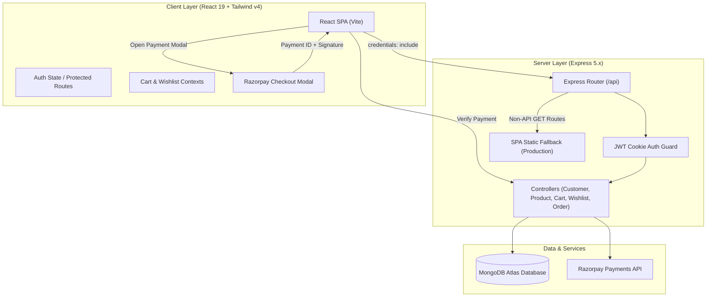

<div align="center">

# 🛒 ShopKart — Modern MERN E-Commerce Platform

**Full-Stack E-Commerce Web Application with Secure HttpOnly JWT Authentication, Relational Wishlist, Dynamic Cart, and Razorpay Payments.**

[](https://nodejs.org/)
[](https://expressjs.com/)
[](https://react.dev/)
[](https://tailwindcss.com/)
[](https://www.mongodb.com/)
[](https://razorpay.com/)
[](LICENSE)

<br />

[Live Demo](#-deployment-guide) • [Architecture](#-system-architecture) • [Features](#-core-features) • [API Docs](#-api-reference) • [Deployment Guide](#-smooth-deployment-guide) • [Viva Prep](file:///c:/Users/rehan/MERN/mern-lab-shopkart/Viva.md)

</div>

---

## 📑 Table of Contents

1. [Project Overview](#-project-overview)
2. [Core Features](#-core-features)
3. [System Architecture](#-system-architecture)
4. [Tech Stack](#-tech-stack)
5. [Project Structure](#-project-structure)
6. [Getting Started Locally](#-getting-started-locally)
7. [Environment Variables](#-environment-variables)
8. [REST API Reference](#-rest-api-reference)
9. [Smooth Deployment Guide](#-smooth-deployment-guide)
   - [Method A: Single-Service Monolithic Deployment (Render / Railway)](#method-a-single-service-full-stack-deployment-recommended)
   - [Method B: Decoupled Deployment (Vercel + Render)](#method-b-decoupled-deployment-frontend-on-vercel--backend-on-render)
10. [Troubleshooting & Gotchas](#-troubleshooting--gotchas)
11. [Academic Lab Engineering Guide](#-academic-lab-engineering-guide)

---

## 🌟 Project Overview

**ShopKart** is a production-grade, full-stack MERN application engineered with modern best practices. Built from the ground up to solve common e-commerce engineering challenges, it emphasizes:

- **Bulletproof Auth Security**: Session management via `HttpOnly`, `SameSite`, and `Secure` cookies protecting against Cross-Site Scripting (XSS).
- **Normalized Relational Data**: MongoDB schemas using relational `ObjectId` references populated dynamically to prevent stale data duplication.
- **Enterprise Checkout Lifecycle**: Two-phase payment pipeline using Razorpay with backend cryptographic HMAC SHA256 signature verification.
- **High-Performance UI**: React 19 single-page application enhanced with GSAP micro-animations, Tailwind CSS v4, and Lucide icons.

---

## ✨ Core Features

### 🔐 1. Customer Authentication (Lab 01 & 02)
- **One-Way Password Hashing**: Passwords hashed with `bcrypt` with adaptive salt rounds before database persistence.
- **XSS-Immune JWTs**: Cryptographic JSON Web Tokens delivered strictly inside `HttpOnly` browser cookies.
- **Session Verification**: Dedicated `/api/customers/me` endpoint ensures the server remains the single source of truth on browser reload.
- **Safe Password Updates**: Protected route requiring old password verification before saving new credentials.

### 🔍 2. Product Discovery & Filtering (Lab 03)
- **Real-Time Search**: Server-accelerated product title and description querying.
- **Category & Price Aggregation**: Granular faceted navigation without downloading raw datasets to the client.
- **Rich Product Views**: Multi-image galleries, real-time stock counters, and rating indicators.

### ❤️ 3. Customer Wishlist (Lab 04)
- **Relational Referencing**: Wishlists store product `ObjectId` references (`ref: 'Product'`), dynamically populated via Mongoose `.populate()`.
- **Atomic Heart Toggles**: Instant optimistic updates with persistent state sync.

### 🛍️ 4. Shopping Cart & Inventory (Lab 05)
- **Cart State Management**: Increment, decrement, and removal actions with real-time recalculation of subtotals and free-shipping thresholds.
- **Persistence Across Sessions**: Synced with MongoDB for authenticated customers.

### 💳 5. Orders & Razorpay Checkout (Lab 06)
- **Step 1: Order Generation**: Server initiates Razorpay Order ID with strict currency validation.
- **Step 2: Client Modal Execution**: In-browser Razorpay modal supporting Test Cards, Netbanking, UPI, and Wallets.
- **Step 3: Cryptographic Verification**: Backend validates `razorpay_signature` using HMAC SHA256 before marking the order as `PAID`.
- **Order Tracking & Receipts**: Comprehensive timeline and invoice summaries for every order.

---

## 📐 System Architecture



---

## 🛠️ Tech Stack

| Domain | Technology | Purpose |
| :--- | :--- | :--- |
| **Frontend Core** | React 19, Vite 8 | Fast React SPA framework with Hot Module Replacement |
| **Styling** | Tailwind CSS v4 | Modern styling tokens, responsive grids, and transitions |
| **Animations** | GSAP 3 | Micro-interactions, banner reveals, and interactive hover states |
| **Icons** | Lucide React | Consistent, scalable vector interface icons |
| **Backend Core** | Node.js, Express 5.x | RESTful API server and static production asset server |
| **Database** | MongoDB & Mongoose 9.x | Document database with relational schemas & population |
| **Security** | `bcrypt`, `jsonwebtoken`, `cookie-parser` | Salted password hashing and HttpOnly JWT cookie auth |
| **Payments** | Razorpay Node SDK | Secure payment generation and HMAC-SHA256 verification |

---

## 📁 Project Structure

```text
mern-lab-shopkart/
├── backend/
│   ├── config/             # Database and payment configurations
│   ├── controllers/        # Request handling logic (Auth, Products, Cart, Wishlist, Orders)
│   ├── middlewares/        # JWT cookie authentication verification middleware
│   ├── models/             # Mongoose schemas (Customer, Product, Wishlist, Cart, Order)
│   ├── routes/             # Express API route modules
│   ├── utils/              # Token generation & helper utilities
│   ├── .env.example        # Backend environment variables template
│   ├── index.js            # Express server entry point & static SPA fallback
│   └── package.json        # Backend dependencies & scripts
├── frontend/
│   ├── public/             # Static web assets
│   ├── src/
│   │   ├── api/            # Low-level authentication fetch clients
│   │   ├── components/     # Reusable UI widgets (Navbar, Footer, Modals, ProductCards)
│   │   ├── context/        # React Context providers (CartContext, WishlistContext)
│   │   ├── pages/          # Routed views (Home, Products, Cart, Checkout, Orders, Wishlist)
│   │   ├── services/       # Centralized API service layer & Razorpay SDK loader
│   │   ├── App.jsx         # Client routing definitions
│   │   └── main.jsx        # Root React mount
│   ├── vercel.json         # Vercel SPA routing rewrite configuration
│   ├── vite.config.js      # Vite build setup with /api proxy
│   └── package.json        # Frontend dependencies & scripts
├── package.json            # Monorepo root scripts (dev, build, start)
├── Viva.md                 # Full TA Engineering Viva guide (Labs 01-05)
└── README.md               # Primary project documentation
```

---

## 🚀 Getting Started Locally

### 1. Prerequisites
- **Node.js**: v18.0.0 or higher ([Download Node.js](https://nodejs.org/))
- **MongoDB Atlas** account or local MongoDB instance running on `localhost:27017`
- **Razorpay Account** (Test Mode enabled)

### 2. Clone Repository & Install All Dependencies
```bash
git clone https://github.com/RehanIslam09/ShopKart.git
cd mern-lab-shopkart

# Install dependencies in both backend and frontend in one command
npm run install:all
```

### 3. Configure Backend Environment
Create a `.env` file in the `backend/` folder:
```bash
cd backend
cp .env.example .env
```
Fill in your credentials:
```env
PORT=5000
NODE_ENV=development
CLIENT_URL=http://localhost:5173

MONGO_URI=mongodb+srv://<username>:<password>@cluster0.mongodb.net/?retryWrites=true&w=majority
JWT_SECRET=super_secure_jwt_secret_key_123

RAZORPAY_KEY_ID=rzp_test_xxxxxxxxxxxxx
RAZORPAY_KEY_SECRET=your_razorpay_secret_key
```

### 4. Run Development Servers
From the **root folder**:
```bash
npm run dev
```
> ✨ This starts both the Express server on port `5000` and the Vite React server on port `5173` concurrently with color-coded logs!

Open your browser at:
- **Frontend**: [http://localhost:5173](http://localhost:5173)
- **Backend Health Check**: [http://localhost:5000/api/health](http://localhost:5000/api/health)

---

## 🔑 Environment Variables

| Variable | Location | Required | Description | Example |
| :--- | :--- | :--- | :--- | :--- |
| `PORT` | `backend/.env` | Optional | Port for the Express server (Default: `5000`) | `5000` |
| `NODE_ENV` | `backend/.env` | Recommended | Environment mode (`development` or `production`) | `production` |
| `MONGO_URI` | `backend/.env` | **Yes** | MongoDB Atlas connection string | `mongodb+srv://...` |
| `JWT_SECRET` | `backend/.env` | **Yes** | Cryptographic secret for signing JWT cookies | `random_secret_hash` |
| `CLIENT_URL` | `backend/.env` | Production | Allowed origin(s) for CORS (comma-separated) | `https://my-shopkart.vercel.app` |
| `RAZORPAY_KEY_ID` | `backend/.env` | **Yes** | Razorpay Test Key ID | `rzp_test_xxxxxxxxx` |
| `RAZORPAY_KEY_SECRET` | `backend/.env` | **Yes** | Razorpay Test Key Secret | `abcdef123456...` |

---

## 📡 REST API Reference

### 🔐 Customer Authentication (`/api/customers`)
| Method | Endpoint | Access | Description |
| :--- | :--- | :--- | :--- |
| `POST` | `/api/customers/register` | Public | Create new customer account |
| `POST` | `/api/customers/login` | Public | Authenticate user & attach HttpOnly cookie |
| `GET` | `/api/customers/me` | Protected | Fetch current authenticated user session |
| `POST` | `/api/customers/logout` | Protected | Clear HttpOnly authentication cookie |
| `PATCH` | `/api/customers/change-password` | Protected | Change existing account password |

### 📦 Products Catalog (`/api/products`)
| Method | Endpoint | Access | Description |
| :--- | :--- | :--- | :--- |
| `GET` | `/api/products` | Public | Get all products (supports `?category=`, `?search=`) |
| `GET` | `/api/products/:id` | Public | Fetch canonical details for a single product |

### ❤️ Customer Wishlist (`/api/wishlist`)
| Method | Endpoint | Access | Description |
| :--- | :--- | :--- | :--- |
| `GET` | `/api/wishlist` | Protected | Fetch authenticated user's wishlist (populated) |
| `POST` | `/api/wishlist/toggle` | Protected | Add or remove product ID from customer wishlist |

### 🛒 Shopping Cart (`/api/cart`)
| Method | Endpoint | Access | Description |
| :--- | :--- | :--- | :--- |
| `GET` | `/api/cart` | Protected | Fetch active cart items and price summaries |
| `POST` | `/api/cart/add` | Protected | Add an item to cart or increment quantity |
| `PUT` | `/api/cart/update` | Protected | Set specific quantity for cart item |
| `DELETE` | `/api/cart/:productId` | Protected | Remove item from cart |

### 💳 Orders & Payments (`/api/orders`)
| Method | Endpoint | Access | Description |
| :--- | :--- | :--- | :--- |
| `POST` | `/api/orders/create-payment-order` | Protected | Initiate Razorpay order and get `order_id` |
| `POST` | `/api/orders/verify-payment` | Protected | Verify HMAC-SHA256 signature and finalize order |
| `GET` | `/api/orders` | Protected | Fetch customer order history |
| `GET` | `/api/orders/:id` | Protected | Fetch detailed order receipt |

---

## 🚀 Smooth Deployment Guide

Here are two battle-tested deployment strategies. **Method A** is the simplest and recommended because it eliminates cross-origin cookie blockers completely.

---

### Method A: Single-Service Full-Stack Deployment (Recommended)
> 💡 **Why this is the smoothest**: Express builds and serves the React Vite production bundle (`frontend/dist`) as static assets, while handling all `/api` requests on the exact same domain. You have **zero CORS problems**, **zero cross-site cookie blocking on Safari/Chrome**, and **only one service to maintain**.

Supported platforms: **Render (Web Service)**, **Railway**, **Fly.io**, **Cyclic**.

#### Step-by-Step on Render:
1. Push your repository to GitHub.
2. Sign in to [Render Dashboard](https://dashboard.render.com/) and click **New +** → **Web Service**.
3. Select your GitHub repository (`ShopKart`).
4. Configure the service settings:
   - **Name**: `shopkart`
   - **Region**: Closest to your users (e.g., Singapore / Frankfurt)
   - **Branch**: `main`
   - **Root Directory**: *(leave blank — defaults to project root)*
   - **Environment**: `Node`
   - **Build Command**:
     ```bash
     npm run install:all && npm run build
     ```
   - **Start Command**:
     ```bash
     npm start
     ```
5. Scroll down to **Environment Variables** and add:
   - `NODE_ENV`: `production`
   - `MONGO_URI`: `your_mongodb_atlas_connection_string`
   - `JWT_SECRET`: `your_random_strong_secret`
   - `RAZORPAY_KEY_ID`: `your_razorpay_key_id`
   - `RAZORPAY_KEY_SECRET`: `your_razorpay_key_secret`
6. Click **Deploy Web Service**! Once deployment finishes, visit your live URL — your entire MERN app is live with zero extra setup!

---

### Method B: Decoupled Deployment (Frontend on Vercel + Backend on Render)

If you prefer hosting the React client separately on Vercel's global Edge CDN:

#### 1. Deploy Backend on Render:
1. In Render, select **New +** → **Web Service**.
2. Set **Root Directory**: `backend`
3. **Build Command**: `npm install`
4. **Start Command**: `npm start`
5. Set Environment Variables:
   - `NODE_ENV`: `production`
   - `MONGO_URI`: `your_mongodb_connection_string`
   - `JWT_SECRET`: `your_jwt_secret`
   - `RAZORPAY_KEY_ID`: `your_razorpay_key_id`
   - `RAZORPAY_KEY_SECRET`: `your_razorpay_key_secret`
   - `CLIENT_URL`: `https://your-frontend-app.vercel.app` *(Your Vercel URL)*
6. Copy the deployed backend URL (e.g., `https://shopkart-api.onrender.com`).

#### 2. Deploy Frontend on Vercel:
1. Go to [Vercel Dashboard](https://vercel.com/) → **Add New Project**.
2. Select your repository.
3. In the project setup:
   - **Framework Preset**: `Vite`
   - **Root Directory**: Click edit and choose `frontend`.
4. Our repository includes [`frontend/vercel.json`](file:///c:/Users/rehan/MERN/mern-lab-shopkart/frontend/vercel.json) out of the box, ensuring all SPA deep links redirect to `index.html` without 404 errors!
5. In `frontend/vite.config.js` or through Vercel Rewrites, you can proxy `/api` calls directly to your Render backend:
   ```json
   {
     "rewrites": [
       {
         "source": "/api/:path*",
         "destination": "https://shopkart-api.onrender.com/api/:path*"
       },
       {
         "source": "/(.*)",
         "destination": "/index.html"
       }
     ]
   }
   ```
6. Click **Deploy**!

---

### ⚠️ Crucial Database Network Step for All Deployments:
To allow your deployed cloud servers to communicate with MongoDB Atlas:
1. Open [MongoDB Atlas Dashboard](https://cloud.mongodb.com/).
2. Navigate to **Security** → **Network Access**.
3. Click **Add IP Address**.
4. Choose **Allow Access from Anywhere** (`0.0.0.0/0`) and click **Confirm**.
*(Render and Vercel use dynamic outbound IP addresses, so `0.0.0.0/0` is mandatory for serverless/cloud hosting).*

---

## 🛠️ Troubleshooting & Gotchas

### 1. MongoDB Connection Blocked (Hostel / Campus Wi-Fi)
- **Symptom**: `MongooseServerSelectionError: connect ECONNREFUSED` or `ETIMEDOUT`.
- **Reason**: Educational institute Wi-Fi firewalls often block standard MongoDB Atlas outbound ports (`27017`).
- **Fix**: Switch temporarily to a mobile hotspot or use a VPN. The backend also includes an in-memory fallback store so auth won't crash when offline!

### 2. Cross-Origin Cookies Blocked in Chrome
- **Reason**: When frontend (`vercel.app`) and backend (`onrender.com`) are on different domains, Chrome classifies cookies as third-party.
- **Fix**: Either:
  1. Use **Method A** (Single-service deployment) so frontend and backend share the exact same domain.
  2. Use Vercel's `rewrites` so `/api` is requested on the same Vercel origin.

### 3. Razorpay Modal Doesn't Appear
- **Reason**: `https://checkout.razorpay.com/v1/checkout.js` was blocked or not loaded.
- **Fix**: ShopKart includes a safe dynamic script injector in [`frontend/src/services/payment.js`](file:///c:/Users/rehan/MERN/mern-lab-shopkart/frontend/src/services/payment.js) which handles script injection and verifies key presence before launching.

---

## 🎓 Academic Lab Engineering Guide

Detailed technical explanations for lab exams and viva preparation can be found in our dedicated guide:
👉 **[View TA Viva Preparation Guide (Labs 01 – 05)](file:///c:/Users/rehan/MERN/mern-lab-shopkart/Viva.md)**

Key concepts covered in depth:
- `bcrypt` one-way adaptive hashing vs two-way encryption.
- JWT structure, signature verification, and payload security.
- `HttpOnly`, `SameSite`, and `Secure` cookie flags.
- Normalized relational `ObjectId` references vs subdocuments.
- Client-side vs server-side filtering performance trade-offs.

---

<div align="center">
  <b>Built with ❤️ by Rehan Islam</b>
  <br />
  <sub>ShopKart — MERN Stack Engineering</sub>
</div>
